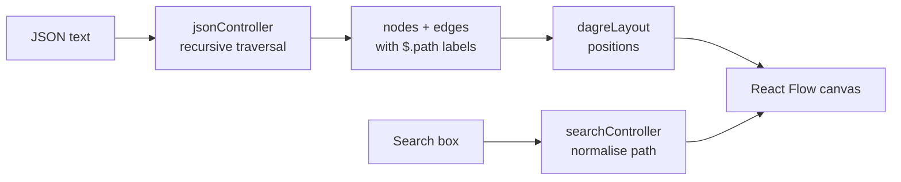

<div align="center">

# 🌳 JSON Tree Visualizer

**Paste any JSON and explore it as an interactive node graph. Search by path, zoom, pan and auto-layout.**


### [🌐 Live demo](https://ap-iwizflowise.vercel.app)

</div>

---

## ✨ Features

- **Visualise JSON as a tree**: objects, arrays and primitive values become colour-coded nodes connected by edges
- **Auto layout** with [dagre](https://github.com/dagrejs/dagre), so even deeply nested JSON stays readable
- **Search by JSONPath-style path** (`$.user.address.city` or `items[0].title`), which highlights the matching node
- **Interactive canvas**: zoom, pan, fit-to-view, minimap and controls (React Flow)
- **Resizable sidebar** and **fullscreen** mode
- **Keyboard shortcut**: <kbd>Ctrl</kbd>/<kbd>⌘</kbd> + <kbd>Enter</kbd> to visualise
- **Copy** the input JSON to the clipboard

## 🧠 How it works



Search paths are normalised: brackets become dots, the root `$` is added if missing, and matching is
case-insensitive. So `items[0].Title` matches `$.items.0.title`.

## 🚀 Run locally

```bash
git clone https://github.com/mayurvij22/APIwizflowise.git
cd APIwizflowise
npm install
npm run dev      # http://localhost:5173
```

## 📁 Project structure

```text
src/
├── pages/Home.jsx                 # Layout, shortcuts, fullscreen, resizable sidebar
├── components/
│   ├── InputPanel.jsx             # JSON input and validation
│   ├── SearchBar.jsx              # Path search
│   └── TreeCanvas.jsx             # React Flow canvas
└── controllers/
    ├── jsonController.js          # JSON → nodes/edges
    ├── searchController.js        # Path normalisation and matching
    └── layout/dagreLayout.js      # Auto layout
```

## 🛠️ Tech stack

React 19 · Vite · React Flow · dagre · Tailwind CSS · Deployed on Vercel

---

<div align="center">

Made by **[Mayur Patil](https://github.com/mayurvij22)**

</div>
